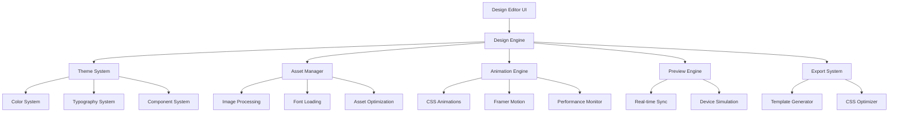
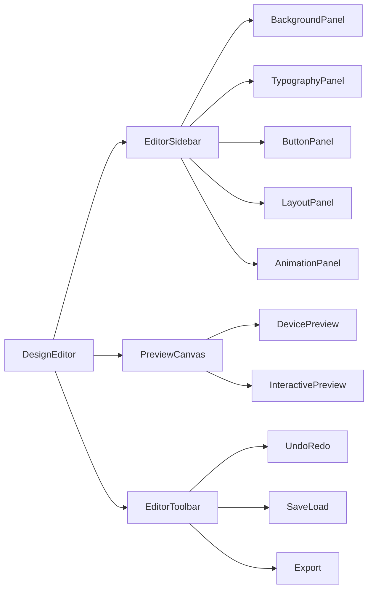

# Design Document - Design System 2.0

## Overview

O Design System 2.0 é uma reimaginação completa da experiência de personalização do LinkHub, oferecendo um editor visual moderno e intuitivo que permite aos usuários criar páginas de links verdadeiramente únicas. O sistema combina a simplicidade de uso com poder profissional, utilizando tecnologias modernas para entregar uma experiência fluida e responsiva.

## Architecture

### High-Level Architecture



### Component Architecture



## Components and Interfaces

### 1. Design Editor Core

#### DesignEditor Component
```typescript
interface DesignEditorProps {
  profileId: string;
  initialTheme?: ThemeConfig;
  onSave: (theme: ThemeConfig) => Promise<void>;
  onPreview: (theme: ThemeConfig) => void;
}

interface ThemeConfig {
  id: string;
  name: string;
  background: BackgroundConfig;
  typography: TypographyConfig;
  buttons: ButtonConfig;
  layout: LayoutConfig;
  animations: AnimationConfig;
  colors: ColorPalette;
  effects: EffectConfig;
  metadata: ThemeMetadata;
}
```

#### Design State Management
```typescript
interface DesignState {
  currentTheme: ThemeConfig;
  history: ThemeConfig[];
  historyIndex: number;
  isPreviewMode: boolean;
  selectedElement: string | null;
  deviceMode: 'mobile' | 'desktop' | 'tablet';
  isDirty: boolean;
}

interface DesignActions {
  updateTheme: (updates: Partial<ThemeConfig>) => void;
  undo: () => void;
  redo: () => void;
  setSelectedElement: (elementId: string | null) => void;
  setDeviceMode: (mode: DeviceMode) => void;
  saveTheme: () => Promise<void>;
  loadTheme: (themeId: string) => Promise<void>;
}
```

### 2. Background System

#### Background Configuration
```typescript
interface BackgroundConfig {
  type: 'solid' | 'gradient' | 'image' | 'video' | 'pattern';
  solid?: {
    color: string;
  };
  gradient?: {
    type: 'linear' | 'radial' | 'conic';
    colors: GradientStop[];
    direction: number;
    position: { x: number; y: number };
  };
  image?: {
    url: string;
    position: 'center' | 'top' | 'bottom' | 'left' | 'right' | 'custom';
    size: 'cover' | 'contain' | 'auto' | 'custom';
    repeat: 'no-repeat' | 'repeat' | 'repeat-x' | 'repeat-y';
    filters: ImageFilters;
    overlay?: OverlayConfig;
  };
  video?: {
    url: string;
    opacity: number;
    filters: VideoFilters;
    autoplay: boolean;
    loop: boolean;
    muted: boolean;
  };
  pattern?: {
    type: string;
    color: string;
    size: number;
    opacity: number;
  };
}

interface GradientStop {
  color: string;
  position: number;
}

interface ImageFilters {
  blur: number;
  brightness: number;
  contrast: number;
  saturate: number;
  sepia: number;
  hueRotate: number;
}
```

#### Background Panel Component
```typescript
const BackgroundPanel: React.FC<{
  config: BackgroundConfig;
  onChange: (config: BackgroundConfig) => void;
}> = ({ config, onChange }) => {
  return (
    <div className="space-y-6">
      <BackgroundTypeSelector />
      <BackgroundControls />
      <BackgroundPreview />
      <BackgroundEffects />
    </div>
  );
};
```

### 3. Typography System

#### Typography Configuration
```typescript
interface TypographyConfig {
  fontFamily: FontConfig;
  heading: TextStyle;
  body: TextStyle;
  caption: TextStyle;
  button: TextStyle;
  customFonts: CustomFont[];
}

interface FontConfig {
  primary: string;
  secondary?: string;
  fallback: string[];
  weights: number[];
  subsets: string[];
}

interface TextStyle {
  fontSize: ResponsiveValue<number>;
  fontWeight: number;
  lineHeight: number;
  letterSpacing: number;
  textTransform: 'none' | 'uppercase' | 'lowercase' | 'capitalize';
  textDecoration: 'none' | 'underline' | 'line-through';
  color: string;
  effects: TextEffects;
}

interface TextEffects {
  shadow: TextShadow[];
  outline: TextOutline;
  gradient: TextGradient;
  animation: TextAnimation;
}

interface ResponsiveValue<T> {
  mobile: T;
  tablet: T;
  desktop: T;
}
```

#### Typography Panel Component
```typescript
const TypographyPanel: React.FC<{
  config: TypographyConfig;
  onChange: (config: TypographyConfig) => void;
}> = ({ config, onChange }) => {
  return (
    <div className="space-y-6">
      <FontSelector />
      <FontWeightSelector />
      <TextStyleControls />
      <TextEffectsPanel />
      <ResponsiveControls />
    </div>
  );
};
```

### 4. Button System

#### Button Configuration
```typescript
interface ButtonConfig {
  default: ButtonStyle;
  hover: ButtonStyle;
  active: ButtonStyle;
  variants: Record<string, ButtonVariant>;
  layout: ButtonLayout;
  animations: ButtonAnimations;
}

interface ButtonStyle {
  background: BackgroundConfig;
  border: BorderConfig;
  shadow: ShadowConfig;
  typography: TextStyle;
  effects: VisualEffects;
}

interface ButtonLayout {
  width: 'full' | 'auto' | 'custom';
  height: number;
  padding: SpacingConfig;
  margin: SpacingConfig;
  borderRadius: ResponsiveValue<number>;
  alignment: 'left' | 'center' | 'right';
}

interface ButtonAnimations {
  hover: AnimationConfig;
  click: AnimationConfig;
  entrance: AnimationConfig;
}

interface VisualEffects {
  glassmorphism: GlassmorphismConfig;
  neumorphism: NeumorphismConfig;
  glow: GlowConfig;
  blur: BlurConfig;
}
```

### 5. Color System

#### Color Palette Management
```typescript
interface ColorPalette {
  primary: ColorScale;
  secondary: ColorScale;
  accent: ColorScale;
  neutral: ColorScale;
  semantic: SemanticColors;
  custom: CustomColor[];
}

interface ColorScale {
  50: string;
  100: string;
  200: string;
  300: string;
  400: string;
  500: string; // Base color
  600: string;
  700: string;
  800: string;
  900: string;
}

interface SemanticColors {
  success: string;
  warning: string;
  error: string;
  info: string;
}

interface ColorHarmony {
  type: 'monochromatic' | 'analogous' | 'complementary' | 'triadic' | 'tetradic';
  baseColor: string;
  colors: string[];
  accessibility: AccessibilityReport;
}
```

#### Intelligent Color System
```typescript
class ColorIntelligence {
  generateHarmony(baseColor: string, type: HarmonyType): ColorHarmony;
  checkContrast(foreground: string, background: string): ContrastReport;
  suggestPalette(brandColor: string): ColorPalette;
  generateAccessibleVariants(color: string): ColorScale;
  analyzeTrendingColors(): TrendingPalette[];
}

interface ContrastReport {
  ratio: number;
  wcagAA: boolean;
  wcagAAA: boolean;
  recommendations: string[];
}
```

### 6. Animation Engine

#### Animation Configuration
```typescript
interface AnimationConfig {
  entrance: EntranceAnimation[];
  hover: HoverAnimation[];
  scroll: ScrollAnimation[];
  micro: MicroInteraction[];
  global: GlobalAnimations;
}

interface EntranceAnimation {
  element: string;
  type: 'fade' | 'slide' | 'scale' | 'rotate' | 'bounce';
  direction?: 'up' | 'down' | 'left' | 'right';
  duration: number;
  delay: number;
  easing: string;
  stagger?: number;
}

interface MicroInteraction {
  trigger: 'hover' | 'click' | 'focus';
  element: string;
  animation: KeyframeAnimation;
  feedback: HapticFeedback;
}

interface PerformanceConfig {
  useGPU: boolean;
  respectReducedMotion: boolean;
  maxAnimations: number;
  fallbackStatic: boolean;
}
```

### 7. Template System

#### Template Management
```typescript
interface Template {
  id: string;
  name: string;
  description: string;
  category: TemplateCategory;
  preview: string;
  theme: ThemeConfig;
  tags: string[];
  popularity: number;
  author: TemplateAuthor;
  isPremium: boolean;
  price?: number;
}

interface TemplateCategory {
  id: string;
  name: string;
  description: string;
  icon: string;
  color: string;
}

interface TemplateMarketplace {
  featured: Template[];
  categories: TemplateCategory[];
  trending: Template[];
  recent: Template[];
  userTemplates: Template[];
}
```

## Data Models

### Theme Storage Schema
```sql
-- Themes table for storing complete theme configurations
CREATE TABLE themes (
  id UUID PRIMARY KEY DEFAULT gen_random_uuid(),
  user_id UUID REFERENCES auth.users(id) ON DELETE CASCADE,
  name VARCHAR(100) NOT NULL,
  description TEXT,
  config JSONB NOT NULL,
  preview_image TEXT,
  is_public BOOLEAN DEFAULT false,
  is_premium BOOLEAN DEFAULT false,
  price DECIMAL(10,2),
  category_id UUID REFERENCES theme_categories(id),
  tags TEXT[],
  popularity_score INTEGER DEFAULT 0,
  created_at TIMESTAMP WITH TIME ZONE DEFAULT NOW(),
  updated_at TIMESTAMP WITH TIME ZONE DEFAULT NOW()
);

-- Theme categories
CREATE TABLE theme_categories (
  id UUID PRIMARY KEY DEFAULT gen_random_uuid(),
  name VARCHAR(50) NOT NULL,
  description TEXT,
  icon VARCHAR(50),
  color VARCHAR(7),
  sort_order INTEGER DEFAULT 0
);

-- User theme favorites
CREATE TABLE user_theme_favorites (
  user_id UUID REFERENCES auth.users(id) ON DELETE CASCADE,
  theme_id UUID REFERENCES themes(id) ON DELETE CASCADE,
  created_at TIMESTAMP WITH TIME ZONE DEFAULT NOW(),
  PRIMARY KEY (user_id, theme_id)
);

-- Theme usage analytics
CREATE TABLE theme_usage (
  id UUID PRIMARY KEY DEFAULT gen_random_uuid(),
  theme_id UUID REFERENCES themes(id) ON DELETE CASCADE,
  user_id UUID REFERENCES auth.users(id) ON DELETE CASCADE,
  action VARCHAR(20) NOT NULL, -- 'view', 'apply', 'favorite', 'purchase'
  created_at TIMESTAMP WITH TIME ZONE DEFAULT NOW()
);
```

### Asset Management
```sql
-- User uploaded assets
CREATE TABLE user_assets (
  id UUID PRIMARY KEY DEFAULT gen_random_uuid(),
  user_id UUID REFERENCES auth.users(id) ON DELETE CASCADE,
  filename VARCHAR(255) NOT NULL,
  original_name VARCHAR(255) NOT NULL,
  file_type VARCHAR(50) NOT NULL,
  file_size INTEGER NOT NULL,
  storage_path TEXT NOT NULL,
  optimized_versions JSONB, -- Different sizes/formats
  metadata JSONB, -- Dimensions, color palette, etc.
  created_at TIMESTAMP WITH TIME ZONE DEFAULT NOW()
);

-- Font files
CREATE TABLE custom_fonts (
  id UUID PRIMARY KEY DEFAULT gen_random_uuid(),
  user_id UUID REFERENCES auth.users(id) ON DELETE CASCADE,
  font_family VARCHAR(100) NOT NULL,
  font_weight INTEGER DEFAULT 400,
  font_style VARCHAR(20) DEFAULT 'normal',
  file_path TEXT NOT NULL,
  format VARCHAR(20) NOT NULL, -- 'woff2', 'woff', 'ttf'
  created_at TIMESTAMP WITH TIME ZONE DEFAULT NOW()
);
```

## Error Handling

### Design Editor Error Boundaries
```typescript
class DesignEditorErrorBoundary extends React.Component {
  handleError(error: Error, errorInfo: ErrorInfo) {
    // Log error to monitoring service
    console.error('Design Editor Error:', error, errorInfo);
    
    // Save current state before crash
    this.saveEmergencyBackup();
    
    // Show user-friendly error message
    this.setState({ hasError: true, error });
  }
  
  saveEmergencyBackup() {
    const currentState = this.props.designState;
    localStorage.setItem('design-emergency-backup', JSON.stringify(currentState));
  }
}
```

### Asset Loading Error Handling
```typescript
class AssetManager {
  async loadImage(url: string): Promise<HTMLImageElement> {
    return new Promise((resolve, reject) => {
      const img = new Image();
      img.onload = () => resolve(img);
      img.onerror = () => {
        // Try fallback CDN
        const fallbackUrl = this.getFallbackUrl(url);
        if (fallbackUrl) {
          return this.loadImage(fallbackUrl);
        }
        reject(new Error(`Failed to load image: ${url}`));
      };
      img.src = url;
    });
  }
}
```

## Testing Strategy

### Unit Testing
- **Component Testing**: React Testing Library para todos os componentes
- **Hook Testing**: Testes isolados para custom hooks
- **Utility Testing**: Testes para funções de cores, animações, etc.
- **State Management**: Testes para Zustand stores

### Integration Testing
- **Editor Workflow**: Testes end-to-end do fluxo completo
- **Preview Sync**: Testes de sincronização em tempo real
- **Asset Upload**: Testes de upload e processamento
- **Theme Export**: Testes de exportação e importação

### Performance Testing
- **Render Performance**: Medição de tempos de renderização
- **Memory Usage**: Monitoramento de vazamentos de memória
- **Animation Performance**: FPS durante animações
- **Asset Loading**: Tempos de carregamento de assets

### Accessibility Testing
- **Screen Reader**: Compatibilidade com leitores de tela
- **Keyboard Navigation**: Navegação completa por teclado
- **Color Contrast**: Verificação automática de contraste
- **Motion Preferences**: Respeito a prefers-reduced-motion

## Performance Considerations

### Optimization Strategies
1. **Lazy Loading**: Componentes e assets carregados sob demanda
2. **Code Splitting**: Divisão do bundle por funcionalidade
3. **Memoization**: React.memo e useMemo para componentes pesados
4. **Virtual Scrolling**: Para listas grandes de templates
5. **Web Workers**: Processamento de imagens em background
6. **Service Worker**: Cache inteligente de assets

### Memory Management
```typescript
class DesignMemoryManager {
  private assetCache = new Map<string, any>();
  private maxCacheSize = 50; // MB
  
  cacheAsset(key: string, asset: any) {
    if (this.getCacheSize() > this.maxCacheSize) {
      this.evictOldestAssets();
    }
    this.assetCache.set(key, asset);
  }
  
  cleanup() {
    // Cleanup event listeners
    // Clear intervals/timeouts
    // Dispose of heavy objects
  }
}
```

### Real-time Performance
```typescript
class PreviewSyncManager {
  private updateQueue: ThemeUpdate[] = [];
  private isProcessing = false;
  
  queueUpdate(update: ThemeUpdate) {
    this.updateQueue.push(update);
    this.processQueue();
  }
  
  private async processQueue() {
    if (this.isProcessing) return;
    
    this.isProcessing = true;
    
    // Batch updates for better performance
    const batchedUpdates = this.batchUpdates(this.updateQueue);
    this.updateQueue = [];
    
    await this.applyBatchedUpdates(batchedUpdates);
    
    this.isProcessing = false;
  }
}
```

## Security Considerations

### Asset Upload Security
- **File Type Validation**: Whitelist de tipos permitidos
- **File Size Limits**: Limites por tipo de arquivo
- **Malware Scanning**: Verificação de arquivos suspeitos
- **Content Sanitization**: Limpeza de metadados perigosos

### Theme Sharing Security
- **Content Moderation**: Revisão de templates públicos
- **XSS Prevention**: Sanitização de CSS personalizado
- **Rate Limiting**: Limites de upload e compartilhamento
- **User Permissions**: Controle de acesso granular

This design document provides a comprehensive foundation for implementing the Design System 2.0, covering all major components, data models, and technical considerations needed for a modern, performant, and secure design editor.